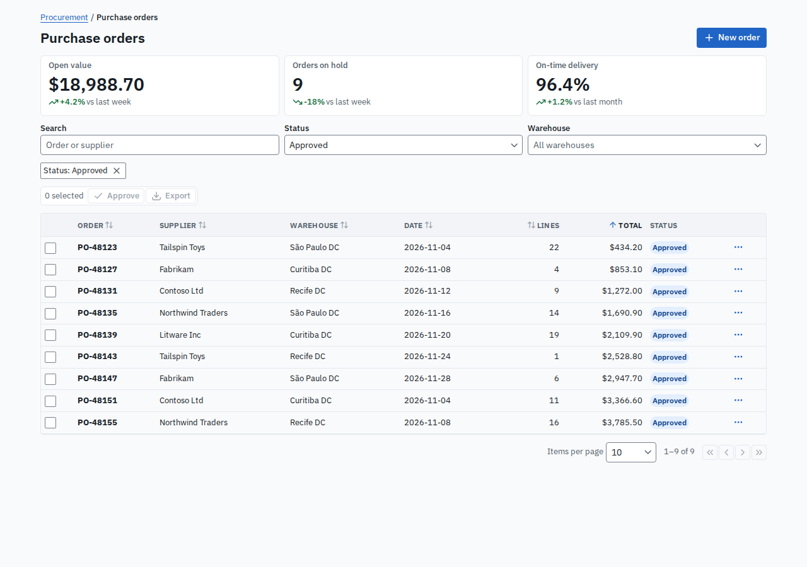
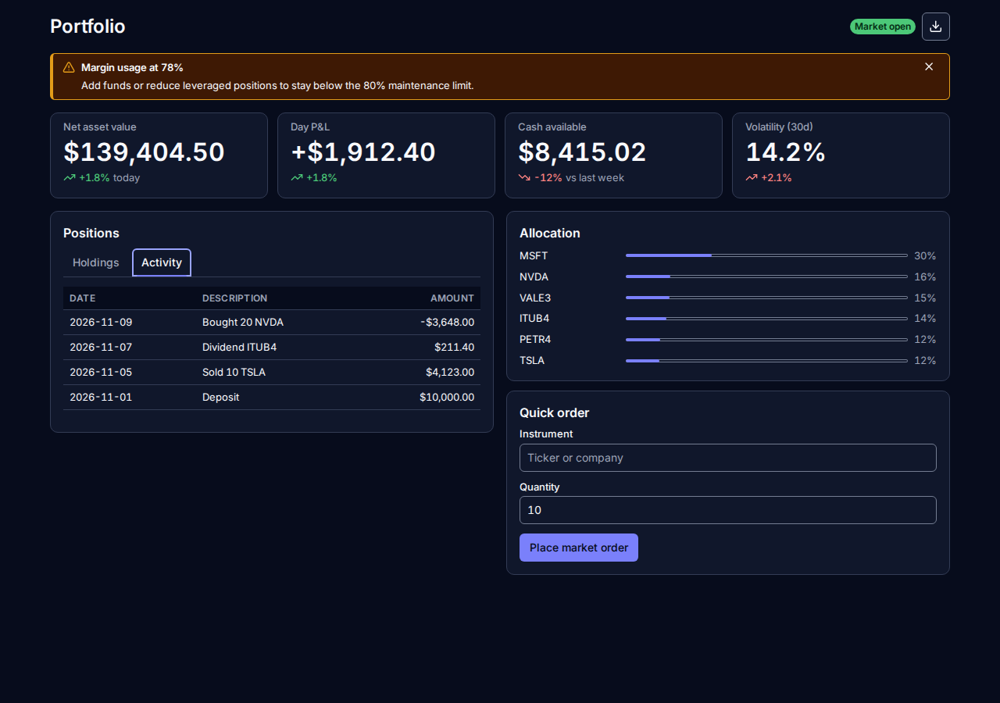
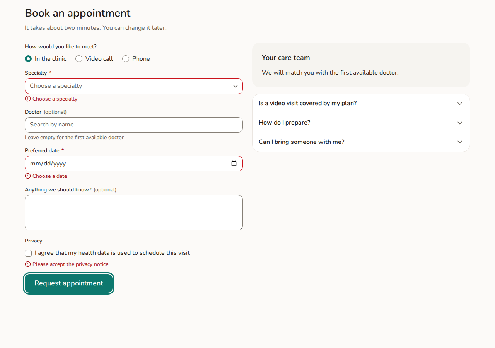

# Tessera

An Angular design system: 35 accessible components, three professional themes (Enterprise, Fintech and Care), each with light and dark modes, documented and tested in Storybook.

**Live Storybook:** https://brunogutierre.github.io/Tessera/. Start with the **Showcase** pages: a purchase-order back office (Enterprise), a portfolio dashboard (Fintech) and an appointment booking form (Care), built only from Tessera components.

| Enterprise · light                                                                                        | Fintech · dark                                                                             | Care · light                                                                                      |
| --------------------------------------------------------------------------------------------------------- | ------------------------------------------------------------------------------------------ | ------------------------------------------------------------------------------------------------- |
|  |  |  |

## Goal

Show how a production-grade design system is built with modern Angular: design tokens as CSS custom properties, runtime theming, headless accessibility primitives (`@angular/aria` and the Angular CDK) with fully custom visuals, and documentation that doubles as a test suite.

## Stack

| Area            | Choice                                                                         |
| --------------- | ------------------------------------------------------------------------------ |
| Framework       | Angular 22 (standalone components, signals, OnPush, zoneless-ready)            |
| Styling         | Plain CSS: custom properties, `oklch()`, `light-dark()`, cascade layers        |
| Behavior        | `@angular/aria` (headless APG widgets) and Angular CDK (overlay, dialog, a11y) |
| Forms           | Signal Forms `FormValueControl`; works with Reactive Forms and `ngModel`       |
| Packaging       | ng-packagr (Angular Package Format), single entry point plus `styles/*`        |
| Documentation   | Storybook 10 (`@storybook/angular-vite`), deployed to GitHub Pages             |
| Unit tests      | Vitest 5 via `@angular/build:unit-test`, browser mode in headless Chromium     |
| Story tests     | `@storybook/addon-vitest` + `@storybook/addon-a11y` (axe, WCAG 2.2 AA)         |
| Visual tests    | Playwright `toHaveScreenshot` in the official Playwright container             |
| Lint and format | angular-eslint (type-checked rules), Prettier                                  |
| Package checks  | publint, `@arethetypeswrong/cli`, `npm pack --dry-run`                         |

## Components

| Component    | Selector                                  | Built on   | Notes                                                                       |
| ------------ | ----------------------------------------- | ---------- | --------------------------------------------------------------------------- |
| Button       | `button[tes-button]`, `a[tes-button]`     | native     | 5 variants, 3 sizes, icon-only, loading (stays focusable)                   |
| Icon         | `tes-icon`                                | inline SVG | 35 icons adapted from Lucide; decorative unless labelled                    |
| Spinner      | `tes-spinner`                             | native     | Indeterminate progressbar; pulses with reduced motion                       |
| Badge        | `tes-badge`                               | native     | 6 tones, subtle or solid; text always states the status                     |
| Tag          | `tes-tag`                                 | native     | Optional remove button named "Remove {text}"                                |
| Avatar       | `tes-avatar`                              | native     | Picture or initials; falls back when the picture fails                      |
| Card         | `tes-card`, `article[tes-card]`           | native     | Outlined, elevated or filled; optional header and footer                    |
| Skeleton     | `tes-skeleton`                            | native     | Text lines, rectangle or circle; always `aria-hidden`                       |
| Alert        | `tes-alert`                               | native     | 4 tones spoken first ("Warning: …"); optional live region                   |
| Progress     | `tes-progress`                            | native     | Determinate or indeterminate progressbar, localized value                   |
| Stat         | `tes-stat`                                | native     | KPI with localized change; `positive` picks the color                       |
| Breadcrumbs  | `tes-breadcrumbs`                         | native     | `nav > ol` over your own `<li>` links (any router)                          |
| Form field   | `tes-form-field`                          | native     | Label, hint and error wired to the control by itself                        |
| Input        | `input[tes-input]`, `textarea[tes-input]` | native     | Native value and validation; textareas grow with content                    |
| Checkbox     | `input[type=checkbox][tes-checkbox]`      | native     | Checked, indeterminate; mark cut out with a CSS mask                        |
| Radio        | `input[type=radio][tes-radio]`            | native     | Browser arrow keys and single tab stop                                      |
| Switch       | `input[type=checkbox][tes-switch]`        | native     | `role="switch"`; knob mirrors in RTL                                        |
| Slider       | `input[type=range][tes-slider]`           | native     | Filled track follows the value, even when set by a form                     |
| Choice       | `label[tes-choice]`                       | native     | Clickable label for a checkbox, radio or switch                             |
| Fieldset     | `fieldset[tes-fieldset]`                  | native     | Legend, hint and error for a group of choices                               |
| Tooltip      | `[tesTooltip]`                            | CDK        | WCAG 1.4.13: dismissible, hoverable; always the description                 |
| Menu         | `tes-menu`                                | Aria + CDK | Menu button with data-driven items, separators, danger                      |
| Select       | `tes-select`                              | Aria + CDK | Single or multiple; a Signal Forms `FormValueControl`                       |
| Listbox      | `tes-listbox`                             | Aria       | Always-visible list, single (follows focus) or multiple                     |
| Autocomplete | `tes-autocomplete`                        | Aria + CDK | Editable combobox, accent-insensitive filter, "no results"                  |
| Tabs         | `tes-tabs`, `tes-tab-panel`               | Aria       | Tabs built from panel labels; hidden panels stay rendered                   |
| Accordion    | `tes-accordion`, `tes-accordion-item`     | Aria       | One section at a time unless `multiple`; lazy content                       |
| Toolbar      | `tes-toolbar`, `[tesToolbarItem]`         | Aria       | Single tab stop, arrow keys, separators                                     |
| Tree         | `tes-tree`                                | Aria       | Data-driven hierarchy; expand, collapse, typeahead, select                  |
| Dialog       | `TesDialog`, `tes-dialog`                 | CDK        | Modal or drawer; focus trap and return, `alertdialog`                       |
| Toast        | `TesToaster`                              | CDK        | Announced, pausable, optional action; never color alone                     |
| Table        | `table[tes-table]`, `th[tes-sort-header]` | native     | Native table, sortable headers with `aria-sort`, `tesSortRows`              |
| Paginator    | `tes-paginator`                           | native     | Page size select, announced range, first to last buttons                    |
| Calendar     | `tes-calendar`                            | native     | Month grid for one ISO date; APG date grid keyboard, min/max, locale-aware  |
| Date picker  | `tes-date-picker`                         | CDK        | Typed locale date plus calendar dialog; `FormValueControl` of an ISO string |

## Themes and design tokens

| Theme          | Built for                    | Character                                             |
| -------------- | ---------------------------- | ----------------------------------------------------- |
| **Enterprise** | ERP, back office, admin      | Dense and sober: IBM Plex Sans, small radii, compact  |
| **Fintech**    | Trading, banking, dashboards | High contrast, dark-first: Inter with tabular numbers |
| **Care**       | Healthcare and services      | Soft and calm: Nunito, large radii, roomy spacing     |

Tokens come in three tiers:

1. **Primitives** (`--tes-palette-blue-600`, `--tes-size-16`): raw values, never used by components.
2. **Semantic tokens** (`--tes-color-primary`, `--tes-control-height-md`): what components read. Every theme defines the same set, listed in `SEMANTIC_TOKENS`.
3. **Component tokens** (`--tes-button-radius`): optional overrides that fall back to semantic tokens.

## Usage

```bash
npm install @brunogutierre/tessera @angular/cdk @angular/aria
```

1. Add `node_modules/@brunogutierre/tessera/styles/tessera.css` to the `styles` of your `angular.json`.
2. Set the first theme in `index.html`, so the first paint is already themed: `<html data-tes-theme="enterprise" data-tes-mode="system">`.
3. Provide Tessera and import the components you use:

```ts
bootstrapApplication(App, {
  providers: [provideTessera({ theme: 'fintech', mode: 'dark', labels: { close: 'Fechar' } })],
});
```

```html
<tes-form-field label="Country" [error]="countryError()">
  <tes-select [options]="countries" [formField]="address.country" />
</tes-form-field>
<button tes-button variant="primary" type="submit">Save</button>
```

Switch at runtime with signals, or theme a subtree with a directive:

```ts
const theme = inject(TesseraTheme);
theme.theme.set('care');
theme.mode.set('system');
theme.resolvedMode(); // 'light' | 'dark'
```

```html
<aside tesTheme="enterprise" tesMode="light">…</aside>
```

Every built-in string (button names, screen-reader text, the paginator summary) comes from `TES_LABELS`, in English by default and overridable through `provideTessera({ labels })`. Any unlayered CSS in your app overrides Tessera, so customizing never needs `!important`.

## Architecture and decisions

### Styling and theming

- **Plain CSS tokens, no Sass and no token pipeline.** Custom properties switch at runtime and cross component boundaries. A pipeline such as Style Dictionary only pays off when tokens must also reach native apps or design tools.
- **`light-dark()` with `color-scheme` for modes.** Each theme defines each color once, `system` mode needs no JavaScript, and a subtree can switch mode by setting one attribute.
- **Cascade layers** (`tessera.tokens`, `tessera.themes`, `tessera.base`, `tessera.components`). Any unlayered app CSS wins over Tessera regardless of specificity.
- **Theme state is two attributes on `<html>`** (`data-tes-theme`, `data-tes-mode`, prefixed so they never clash with an app's `data-theme`). `TesseraTheme` only writes them and the CSS does the rest. It adopts attributes already in `index.html`, so static or server-rendered pages never flash the wrong theme.
- **Contrast is tested, not eyeballed.** Unit tests resolve every token in Chromium and check the 49 foreground/background pairs of `TES_CONTRAST_PAIRS` (exported, so theme packages run the same check) in all six theme and mode combinations: 4.5:1 for text, 3:1 for borders, focus rings and icons. Dark mode puts dark text on bright fills, because one `primary` token must work both as link text and as a button fill.
- **The root font size is left to the browser.** Tokens are in rem; setting a root size once shrank every control below the 24px target size, until a review caught it.
- **Fonts only in Storybook.** The package ships no fonts and its tokens end in system stacks. Storybook loads OFL fonts locally (`@fontsource-variable/*`), so pages and screenshots never depend on a CDN.

### Components and accessibility

- **Native elements stay native.** Components that enhance a native element are attributes on it (`<button tes-button>`, `<input tes-input>`), so `type="submit"`, `href`, `disabled`, ARIA attributes and form bindings work as usual.
- **Behavior comes from `@angular/aria` and the CDK; the visuals are ours.** Containers host Aria's directives with `hostDirectives`, so the panels and items an app projects find their Aria parent through dependency injection, and apps never import Aria. Menus take their items as data, because Aria links a trigger to its menu through a template input.
- **Anchored panels are inline popovers.** Menus, selects and tooltips use the CDK Overlay with the browser Popover API, placed next to their origin. They render in the top layer (no z-index, never clipped), yet stay in the DOM subtree, so a scoped `tesTheme` and encapsulated styles still apply. Dialogs and toasts render at the page level and follow the page theme.
- **Attributes have one owner.** Host bindings merge, never replace, what the app writes (`id`, `aria-describedby`, `aria-invalid`, `aria-disabled`), read through `HostAttributeToken`.
- **Status is never color alone.** Alerts and toasts speak their tone first ("Warning: …"), stats speak the direction of a change, badges carry text, selected rows add a start bar.
- **Disabled has two meanings.** Form controls are natively disabled. Items of composite widgets and buttons that become unavailable right after being pressed are soft-disabled (focusable, `aria-disabled`), so keyboard focus is never thrown to the page.
- **Tables stay native HTML.** A read-only data table is not an interactive grid. `th[tes-sort-header]` adds the sort button and `aria-sort`. Row selection uses a checkbox, since `aria-selected` is only valid on grid rows.
- **The calendar keyboard is hand-written.** `tes-calendar` follows the APG date grid, but moving past the first or last day must change the month, and Page Up/Down change month and year. `@angular/aria/grid` navigates inside a fixed set of cells, so the calendar owns a roving tab stop over a native table with `role="grid"` instead.
- **Icons are drawn from a typed map in the template.** There is no icon font, no runtime registry and no `innerHTML`: unknown names fail at compile time and nothing needs sanitizing.

### Forms

- **No `ControlValueAccessor` anywhere.** Native controls bind through each form library's own accessors. Composite controls (`tes-select`, `tes-listbox`, `tes-autocomplete`, `tes-date-picker`) are Signal Forms `FormValueControl`s (`value` as a `model()` plus a `touch` output); Angular 22 binds that shape from `[formField]`, Reactive Forms and `ngModel` alike, and tests cover all three.
- **Dates are ISO strings.** `tes-date-picker` and `tes-calendar` read and write `YYYY-MM-DD` strings, not `Date` objects: a calendar date has no time zone, the value serializes as is, and equality is `===`. Date math runs in UTC; names, the first day of the week and the typed format come from `LOCALE_ID` through `Intl`, with no date library.
- **The app decides when an error shows.** `tes-form-field` takes the message, not a validation rule, so it works with any form library and any "after blur or submit" policy. The control registers with the field, which wires `for`/`aria-labelledby`, `aria-describedby` and `aria-invalid`.

### Documentation and tests

- **Library-only workspace.** Storybook is the documentation and the playground, so there is no demo app to keep in sync.
- **Storybook on Vite (`@storybook/angular-vite`).** It is the only Angular framework that runs stories as Vitest tests. It is still marked preview, so versions are pinned exactly; the fallback is `@storybook/angular`.
- **Every story is a test, in every theme.** `npm run test:stories` renders each story in Chromium, runs its play function and fails on any axe violation, once per theme and mode, sequentially to keep memory low.
- **Unit tests run in a real browser.** Components rely on the Popover API, focus, `:focus-visible`, `matchMedia` and the CSS cascade; jsdom fakes or lacks all of them. Coverage gate: 80% (currently about 98% of lines).
- **Visual baselines are rendered in the official Playwright container,** locally with podman and in CI, because screenshots only compare reliably with the same browser build and fonts. The per-pixel tolerance is tight (0.02), so a subtle surface color change is caught. The suite holds 70 images: every component in Enterprise light and Fintech dark, open overlays, and the showcase pages in both modes.
- **Lint enforces the conventions.** It checks the `tes` selector prefix, OnPush and signals, so reviews can focus on behavior. See [CONTRIBUTING.md](CONTRIBUTING.md).

## Repository layout

```
projects/brunogutierre/tessera/   the library (@brunogutierre/tessera)
  styles/                         tokens and themes, shipped as @brunogutierre/tessera/styles/*
  src/lib/<component>/            component, styles, spec and stories side by side
  src/lib/core/                   tokens, theme service, labels, overlay defaults
  src/docs/                       MDX pages, foundation stories and the showcase pages
  src/test-utils/                 test helpers (stylesheet loader, color and contrast)
.storybook/                       Storybook config: theme, mode and direction toolbar; fonts
visual/                           Playwright visual regression and its baselines
scripts/test-stories.mjs          runs the story tests once per theme and mode
.github/workflows/                ci.yml (checks), pages.yml (Storybook deploy)
```

## Development

Requirements: Node 24 and npm 11. Browser tests need Chromium: `npx playwright install chromium-headless-shell` (once). Visual tests need podman or Docker.

```bash
npm ci
npm test
```

| Command                         | What it does                                                            |
| ------------------------------- | ----------------------------------------------------------------------- |
| `npm test`                      | Unit tests in headless Chromium                                         |
| `npm run test:coverage`         | Unit tests with coverage thresholds (80%)                               |
| `npm run test:stories`          | Every story as a browser test with axe, in 6 theme/mode runs            |
| `npm run build-storybook`       | Static Storybook in `storybook-static/`                                 |
| `npm run test:visual:container` | Visual regression in the Playwright container (after `build-storybook`) |
| `npm run storybook`             | Storybook at http://localhost:6006                                      |
| `npm run lint`                  | ESLint (TypeScript and templates)                                       |
| `npm run format:check`          | Prettier check (`npm run format` fixes)                                 |
| `npm run build`                 | Builds the library into `dist/`                                         |
| `npm run check:package`         | Build, then publint, attw and `npm pack --dry-run`                      |

To accept an intended visual change: `npm run build-storybook && npm run test:visual:container -- --update-snapshots`.

## Releases

Versions follow SemVer and are listed in [CHANGELOG.md](CHANGELOG.md). Publishing a GitHub Release `vX.Y.Z` runs `.github/workflows/publish.yml`: it checks that the tag matches the package version, runs lint, tests and package checks, and publishes to npm with provenance through npm Trusted Publishing (OIDC, no token).

## Roadmap

- Date range selection and a month/year view in the calendar.
- Storybook 11 once it ships stable (`@storybook/angular-vite` leaves preview).

## License

[MIT](LICENSE). Icons adapted from [Lucide](https://lucide.dev) (ISC), see `THIRD-PARTY-NOTICES.md`.
